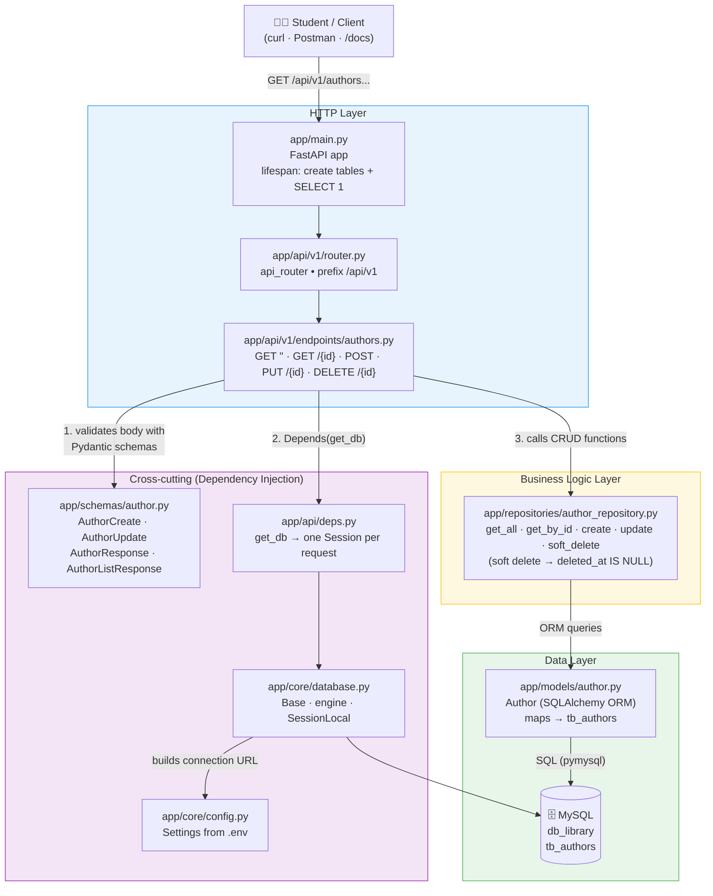
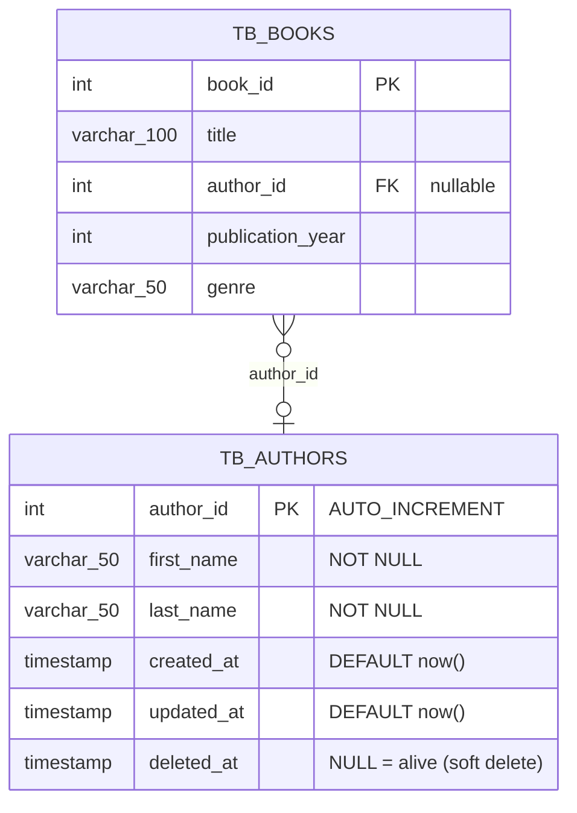

# Architecture Diagrams (Mermaid)

Render these at https://mermaid.js.org or any Mermaid viewer.
Two diagrams: (1) layered architecture / request flow, (2) data model.

## 1. Layered Architecture / Request Flow

## 2. Data Model (tb_authors)

## How to read diagram 1 (the one to present)

A request enters through `main.py` → the v1 router (the "blueprint") → the
`authors` endpoint. The endpoint does three things: validates JSON with
**schemas**, borrows a DB session via **`Depends(get_db)`**, and delegates the
real work to the **repository**, which uses the SQLAlchemy **model** to talk to
MySQL. The purple box is cross-cutting — shared by every resource, so when
students add a new resource (e.g. `books`), they only create a new endpoint +
repository + model and register one line in `router.py`.

## Why DELETE is a soft delete (diagram 2)

`deleted_at` stays `NULL` for alive rows, and every read in the repository
filters `deleted_at IS NULL` — matching the real `db_library` schema.
